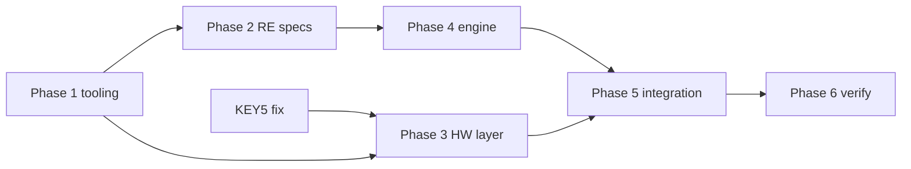

# Plan: port the original iCubeSmart firmware to TinyGo

Background: [../investigation/original-firmware.md](../investigation/original-firmware.md), [../investigation/hardware.md](../investigation/hardware.md)

## Goal and decisions (2026-10-18)

- **All original functionality**, built into the current project structure:
  - every premade show
  - all 4 DIP groups (Dynamic, Audio, Test LED, Text)
  - keys + configurable key functions
  - speed / play mode / display off
  - IR remote
  - UART console / Regedit settings
  - cascade
- Our firmware owns the **whole flash** (no vendor IAP).
- The current test light shows (`internal/show`) and `internal/component/registers` go away. The Pico W link (`led-common-lib/network`) and the desktop app integration stay and keep evolving.
- Extracted vendor data may be committed. **The agent never stages or commits.** You review and commit.
- The agent doesn't install software. Helper scripts are `.cmd`, not make.

## Strategy: "binary-compatible engine"

The vendor firmware is a generic **show engine**. All shows are a **compiled data blob** generated by the PC "3D Software" (`Compile.CompileAllToArray`) and spliced into a firmware hex template.

So instead of hand-porting each animation:

1. **Re-implement the engine in Go:**
   - blob parser
   - graph decompression
   - frame/element renderer (SetGraph + rotate, DrawBall, TitleStyle)
   - script bytecode VM
   - audio cartoons
   - key handling
2. **Embed the original blob byte for byte** (extracted from `1-3D8RGB-Demo-20250128.hex`). Every original show then runs as designed.
3. Bonus: any show made in the PC software can be loaded by extracting the blob from its exported hex. Later the desktop app could produce blobs as well.

Ground truth comes from three sources, in order of usefulness:

| Source | Gives | Tool |
|---|---|---|
| `3D Software - RGB.exe` (.NET) | Exact blob writer, compression codecs, script compiler, key-function enums | ✅ decompiled C# in `.agent/external/decompiled/` |
| `Simulator.dll` (x86 native) | Engine implementation, very likely the same C code as the firmware | Ghidra (installed) |
| Firmware app (`0x08006000…`, Thumb) | Hardware layer: scan timing, color depth, ADC/IR/UART/EEPROM, button/DIP logic, console | Ghidra (installed) |

Plus an **executable oracle**. A host-side Go test built for `GOARCH=386` on Windows loads `Simulator.dll`, runs a show and reads frames with `GetCube`, then compares them with our Go engine running the same blob. This catches renderer and VM mismatches without hardware.

## Phases

### Phase 1: Tooling + extraction (no hardware)

- [x] `scripts\*.cmd`: `build`, `flash`, `monitor`, `dump`, `test-oracle` (COM4 default). The `Makefile` is kept for Linux (target switched to the custom one).
- [x] Custom TinyGo target `targets/gd32f103re.json` + linker script (512 KB flash / 64 KB RAM). The current `bluepill` target caps at 64 KB / 20 KB. Builds must run from the repo root (relative linker script path).
- [x] `tools/fwtool` (host Go): extracts the blob from a vendor hex or a flash dump (`go run ./tools/fwtool <in.hex|in.bin> <out.bin>`). Found by magic `0x12348765` at `0x0800B000`, so no hex diffing needed.
- [x] Ghidra headless projects (scripts under `.agent/tools/ghidra/`) exporting decompiled C into `.agent/re/`:
  - `Simulator.dll` (x86, PE)
  - app low (`0x08006000`) + app high (`0x08032100`), ARM Cortex-M Thumb LE, with peripheral labels
- [x] ILSpy output of `3D Software - RGB.exe` and `Download Software.exe` in `.agent/external/decompiled/` (done by you).
- [x] Ghidra headless decompiles of `Simulator.dll` and the firmware + peripheral annotation. See [../re/README.md](../re/README.md).
- [x] Blob parser `.agent/tools/blobdump` (validated on all 5 vendor hexes and our dump).

### Phase 2: Reverse engineering → specs (desk work)

Each spec goes to `.agent/re/spec-*.md`:

1. **Blob format:** header, resource tables (graph/palette/index), cartoon list per group, frame/element records, script bytecode layout, string table. Source: C# `Compile.*`.
2. **Graph codecs:** `Normal_2/4/8`, `Continue_2/4/8`. Source: C# `Compress.UnCompress_*`.
3. **Renderer semantics:** `SetGraphFun` (rotation axis/angle, placement, palette), `DrawBallFun`, `DrawTitleFun` (styles, font). Source: `Simulator.dll`.
4. **Script VM:** opcodes (enum known), system functions (`SystemFunctionDef`), events, stack/locals, `Error: Stack Out!` limits. Sources: C# compiler + DLL interpreter.
5. **Player:** cartoon sequencing, timing/speed table, play model (single/all loop), key functions `m_key1..7`, groups ↔ DIP switch.
6. **Hardware layer** (firmware only):
   - scan ISR + timer rate, BAM/PWM color depth, layer blanking, frame-buffer format
   - ADC sampling for audio (rate, FFT/bands?)
   - IR decoding + key map
   - UART console grammar + Regedit layout in the 24C02
   - cascade protocol (UART2)
   - `reboot` command

### Phase 3: Hardware foundation in Go (testable tomorrow, independent of RE)

- [x] KEY5 fix + input layer (see [key5-fix-plan.md](key5-fix-plan.md)). `component.Button` (EXTI falling edge, 30 ms debounce). Hardware check: `cmd/gpio_diag`.
- [x] **Display driver:** `component.Scanner`, TIM2 ISR, OE blanking, LE pulse, double buffer, 2 BAM planes (400/800 µs per layer, ~104 Hz). Confirmed on hardware (orientation, colors, DIP groups, keys).
- [x] "Walk one LED" not needed: the Test group (DIP 10) checked bit/LED order and colors on hardware.
- [ ] 24C02 EEPROM driver (I2C1, PB6/PB7).
- [ ] ADC on PA0 (mic), IR capture on PC6, UART2 (PA2/PA3).

### Phase 4: Engine in Go (`internal/engine/...`, host-testable)

- [x] Pure-Go packages with no `machine` imports, so they run under `go test` on the PC: `blob` (+ codec), `render`, `player` (+ VM, resolver), `frame`.
- [x] Oracle tests against `Simulator.dll` (windows/386): all 4 groups + key actions, byte-exact (`scripts\test-oracle.cmd`).
- [x] Size/RAM budget: firmware ≈ 95 KB flash (blob 32 KB stays in flash as an embedded string), ≈ 5.9 KB static RAM.
- Vendor quirk reproduced on purpose: inside one element, interpolating a prop decrements the frame variable by `start` and later props see the modified value (always for Title).

### Phase 5: Integration with the current architecture

- [x] `runner`: `OnboardMode` driven by `engine/player`. DIP group selects the cartoon group at boot. Keys run the blob's key functions. KEY6 long press (≥ 1 s) cycles runner modes.
- [x] Remove `internal/show` (test shows) and `internal/component/registers`. (`tmp/cmd/*` still imports `registers` and no longer builds; it's gitignored.)
- [ ] Audio group: `Player.AudioFrame` is not fed yet (needs the ADC driver + firmware RE of the level → frame mapping).
- [ ] `SerialMode` loop is a placeholder; hook the Pico protocol to `Board.ShowLayout`.
- [ ] Keep `SerialMode` / Pico protocol. Decide later how the desktop app talks to the engine (e.g. upload a blob, select a show, live frames).
- [ ] UART console compatible with the vendor's (`Commands explain`, Regedit, `reboot` into the ROM bootloader).
- [ ] Cascade, IR remote, Audio group.

### Phase 6: Verification on hardware + docs

- [ ] Side-by-side with the original: flash `FullDump_512K.bin` → record → flash ours → compare.
- [ ] README: Windows setup, `scripts\*.cmd`, architecture.

## Order

Phases 1 and 3 can start right away. Phase 3 is what the hardware sessions are for.
