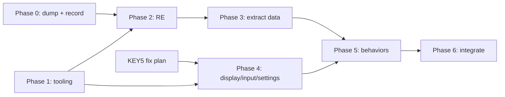

# Plan: port the original iCubeSmart firmware to TinyGo

Background: [../investigation/original-firmware.md](../investigation/original-firmware.md), [../investigation/hardware.md](../investigation/hardware.md)

"Porting a binary" here means: **reverse-engineer what the vendor app does (behavior + data), then re-implement it in Go** on top of the existing architecture (`runner` / `controller` / `component` / `led-common-lib`). The source code doesn't exist, so a literal translation isn't possible. The animation data, however, can be **extracted mechanically** from the binary.

## Phase 0: Secure the original (tomorrow, hardware)

- [ ] Full 512 KB flash dump (twice, compared) plus option bytes. See [../documentation/flashing-and-dumping.md](../documentation/flashing-and-dumping.md).
- [ ] Check whether `0x08032000–0x0803D998` survived.
  - **Yes:** rebuild a complete original image = `Start.hex` + full app.
  - **No:** ask the vendor for the full `update.hex`, and use the Sliicy build as a second reference.
- [ ] Flash the complete original (IAP + app) and **record the reference behavior**:
  - UART1 console log at boot (try 115200 first).
  - Output of the help command ("Commands explain"), and the Regedit dump.
  - Short videos of each DIP group: Dynamic, Audio, Test LED, Text.
  - What every key does.
- [ ] Optional, if you have a logic analyzer: capture CLK/SDI/LE/OE/A..D/154EN for a few ms. That gives the exact scan timing and color-depth scheme.

## Phase 1: Tooling

- [ ] Custom TinyGo target `gd32f103re` (512 KB / 64 KB). Optionally a variant linked at `0x08006000` to keep the vendor IAP.
- [ ] Build/flash script (`tools/flash.ps1`) to replace the POSIX-only `Makefile` on Windows (or fix the Makefile + install make).
- [ ] Ghidra project for the vendor app:
  - ARM Cortex-M Thumb, LE, base `0x08006000`.
  - Load the STM32F103 SVD for peripheral names.
  - Headless export of the decompiled C into `tmp/decompiled/app/`, so it can be grepped.
- [ ] Hex/bin helper (Go, host-side: `tools/fwtool`) to merge, split, diff, list strings, and convert bin↔hex.

## Phase 2: Reverse-engineer (desk work, can start as soon as Phase 0 has a dump)

Document each finding in `.agent/investigation/re-*.md`:

1. **Init and peripherals:** clock tree, timers (which TIM drives the display refresh, at what rate), SPI settings, DMA usage, UART baud rates, ADC, I2C, IR capture.
2. **Display driver:** frame buffer layout, color depth (BAM/PWM bit-planes), layer order, bit order inside the 24-byte frame, blanking.
3. **Data formats:**
   - Pattern/bitmap table (name + size + bytes).
   - Color "series" table.
   - "Cartoon" script records (`x, y, z, dir, type`, speed, repeat, ...).
   - Group lists per DIP setting.
   - Font for the text effects.
4. **Control logic:** keys (Previous/Next/Speed±/Run-Pause/Cycle/ON-OFF), play model (single/all loop), speed table, display off, cube-type config (`8x8x8A`, `8x8x16`, `8x8x32`).
5. **Settings + protocol:** Regedit key/value format in the 24C02, UART command shell grammar, the "3D software" PC protocol (if you have that PC app, a capture of it talking to the cube helps a lot), and UART2 cascade (master/slave sync).
6. **Audio:** ADC sampling rate, any FFT or band split, mapping to bars/waves.

## Phase 3: Data extraction (automated)

- [ ] `tools/fwtool extract` reads the dump and generates Go source (`internal/show/original/*_gen.go`): patterns, color series, scripts, font.
- [ ] Spot-check the generated data against the recorded videos.
- ⚠ **Licensing:** the extracted animation data and fonts are the vendor's. Fine for personal use. Your GitHub repo is public, though. **Decide** whether the generated files are committed or kept local (`.gitignore` + generate at build time from your own dump).

## Phase 4: Core runtime in Go

- [ ] **Display engine:**
  - Timer-ISR driven scan (TIM2 or TIM3; TIM4 is TinyGo's tick).
  - Double-buffered frame, BAM color depth matching the original.
  - Proper OE blanking and LE pulse.
  - Optional SPI DMA.
  - This replaces the current busy-loop `LightLeds`, which has no blanking or timing, causing ghosting and uneven brightness.
- [ ] **Input layer:** debounced keys with events, plus DIP switch read at boot. Depends on the KEY5 fix plan.
- [ ] **Settings:** 24C02 driver (I2C1) and a Regedit-compatible key/value store.

## Phase 5: Behavior port

- [ ] Animation interpreter for the "Cartoon" scripts, plus the extracted data. Group 1 *Dynamic Effects* first.
- [ ] Key functions + speed + play model + ON/OFF.
- [ ] Group 3 *Test LED*: easy, and useful for verifying the driver early.
- [ ] Group 4 *Text Effects* (font + scroller).
- [ ] Group 2 *Audio Effects* (ADC on PA0).
- [ ] IR remote (PC6). Needs the decoded protocol and key map from Phase 2.
- [ ] UART console / PC "3D software" compatibility. Optional, your call.
- [ ] Cascade over UART2. Optional.

## Phase 6: Integrate with your own stack

- [ ] Expose the original shows as `led.LightShow`s, or as a new "OnboardOriginal" mode in `runner`.
- [ ] Keep the Pico W UART protocol (`led-common-lib/network`) working alongside.
- [ ] Update README (Windows setup, flashing).

## Order of work and dependencies

The KEY5 fix and Phase 4 (display engine) don't depend on the reverse engineering, so they can be done in parallel and tested on the hardware tomorrow.
