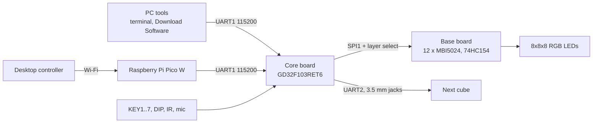

# LED cube documentation

Reference for the iCubeSmart 3D8RGB kit (8×8×8 RGB LED cube) and the firmware in this repository.

| Document | Contents |
|---|---|
| [hardware.md](hardware.md) | Microcontroller, core board, base board, full pin map, keys, DIP switches, IR, microphone, EEPROM, jacks, power |
| [display.md](display.md) | LED driver chain, layer multiplexing, frame bit layout, refresh timing, voxel coordinates |
| [serial-protocol.md](serial-protocol.md) | UART1 console (`#?command?!`), control commands, log output, show upload frames, cascade link, IR remote codes |
| [show-data.md](show-data.md) | Binary show data format (palettes, graphs, indexes, cartoons, scripts) |
| [show-engine.md](show-engine.md) | Player, key functions, renderers, audio level, script VM, built-in shows |
| [storage.md](storage.md) | Flash map, registry format, EEPROM layout, saved settings |
| [firmware.md](firmware.md) | Firmware structure, modes, startup, build, flashing, tools, MCU pitfalls |

Source documents in this repository:

- Schematics: [../diagrams/](../diagrams/)
  - [Yellow small board schematic 黄色小板原理图.pdf](../diagrams/Yellow%20small%20board%20schematic%20黄色小板原理图.pdf): the core board.
  - [3D16RGB Schematic diagram.pdf](../diagrams/3D16RGB%20Schematic%20diagram.pdf): base board pin functions (matches this kit's pin map).
  - [8X8X8RGB Schematic diagram.pdf](../diagrams/8X8X8RGB%20Schematic%20diagram.pdf): base board LED chain (matches this kit's driver count).
  - [3D8RGB Schematic Diagram.pdf](../diagrams/3D8RGB%20Schematic%20Diagram.pdf)
- Manuals: [../manuals/](../manuals/)
  - [GD32F103xx-Datasheet-Rev-2.7.pdf](../manuals/GD32F103xx-Datasheet-Rev-2.7.pdf)
  - [GD32F10x_User_Manual_EN_V2.3-3.pdf](../manuals/GD32F10x_User_Manual_EN_V2.3-3.pdf)
  - [STM32F10x reference manual (RM0008)](../manuals/rm0008-stm32f101xx-stm32f102xx-stm32f103xx-stm32f105xx-and-stm32f107xx-advanced-armbased-32bit-mcus-stmicroelectronics.pdf)
  - [stm32f103rc.pdf](../manuals/stm32f103rc.pdf)

## Overview

Terms used throughout:

- **Voxel**: one RGB LED, 6-bit color `0bRRGGBB` (4 levels per channel).
- **Show**: a list of cartoons plus the key function table.
- **Cartoon**: one animation (a sequence of frames).
- **Mode**: the show selected by DIP switches SW1/SW2 (Dynamic, Audio, Test, Text).
- **Factory firmware**: the firmware the kit ships with.
