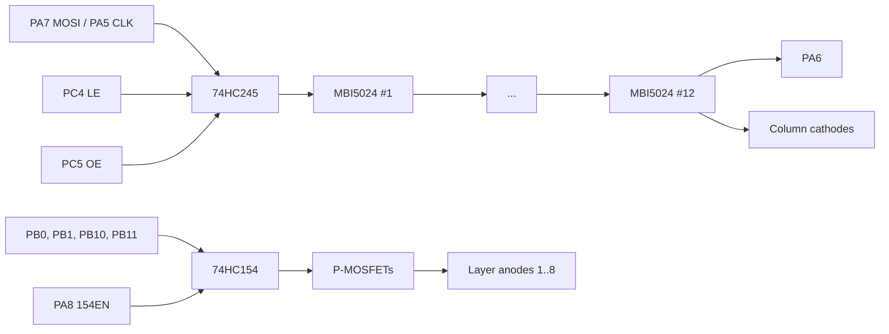

# Display

## Circuit

- **Columns (cathodes)**: 12 MBI5024 constant-current sink drivers in one daisy chain, 16 outputs each, 192 outputs = 8 × 8 columns × 3 colors. All LEDs of a column and color in every layer share one output.
- **Layers (anodes)**: a 74HC154 decoder drives P-MOSFETs that connect 5 V to one layer at a time. Its enable (`154EN`, PA8) is active low and its outputs are active low. Address D (PB11) stays low and the second decoder's enable (PC7) stays high on an 8-layer cube.
- Only one layer is lit at a time; the firmware cycles through the layers fast enough to look continuous.

### MBI5024 signals

| Signal | MCU | Behavior |
|---|---|---|
| SDI | PA7 (SPI1 MOSI) | Shifted in on the CLK rising edge, passed on to the next chip through SDO |
| CLK | PA5 (SPI1 SCK) | Max 25 MHz |
| LE | PC4 | High copies the shift register into the output latches |
| OE | PC5 | **Low enables** the outputs; high blanks them |
| SDO (chain end) | PA6 (SPI1 MISO) | Not used; could read back the chain for a self-test |

The first bit shifted ends up in the **last** chip of the chain.

## Frame layout

A layer is **24 bytes**, sent in order, each byte LSB first (SPI mode 1, LSB first):

| Bytes | Color |
|---|---|
| 0–7 | Green |
| 8–15 | Blue |
| 16–23 | Red |

Within a color, byte *n* is row *n* (z = n) and bit *m* is column *m* (x = m). A 1 bit lights the LED.

## Color depth

A voxel is 6 bits, `0bRRGGBB`: 2 bits (4 levels: off, 1/3, 2/3, full) per channel. The firmware shows each layer twice per refresh, once per bit plane, with binary weighted durations (binary code modulation):

| Plane | Voxel bit per channel | On time per layer |
|---|---|---|
| 0 | low bit (R bit 4, G bit 2, B bit 0) | 400 µs |
| 1 | high bit (R bit 5, G bit 3, B bit 1) | 800 µs |

A full refresh is 8 layers × 1.2 ms = **9.6 ms (≈104 Hz)**.

The factory firmware uses 3 planes shown 1, 3 and 6 of 10 time slots, with a 180/90/45 µs base period depending on the cube type.

## Refresh sequence

TIM2 runs at 1 MHz (prescaler 72). Each update interrupt does:

1. OE high (blank).
2. Advance to the next plane; after the last plane advance to the next layer; after the last layer swap in a pending new frame.
3. Load the timer period for the **following** step (the auto-reload register is preloaded).
4. If the display is off, stop here (the cube stays blank).
5. Shift the 24 bytes of this plane and layer over SPI1.
6. Pulse LE.
7. Set the layer address A–C and pull 154EN low.
8. OE low.

Frames are double buffered: the player encodes into the back buffer and then waits until the interrupt swaps buffers at the start of a refresh, so a frame is never shown half drawn.

## Voxel coordinates

The show engine uses an 8×8×8 buffer, one byte per voxel, index `x + y·8 + z·64`, where **y is up**. The mapping onto the hardware is:

| Engine | Hardware |
|---|---|
| x | column (bit within a row byte) |
| z | row (byte within a color) |
| y | layer, 0 = bottom |

The firmware has a mapping option to mirror x, mirror z, flip the layers or swap x and z, for cubes built in another orientation. The kit needs none of them.
