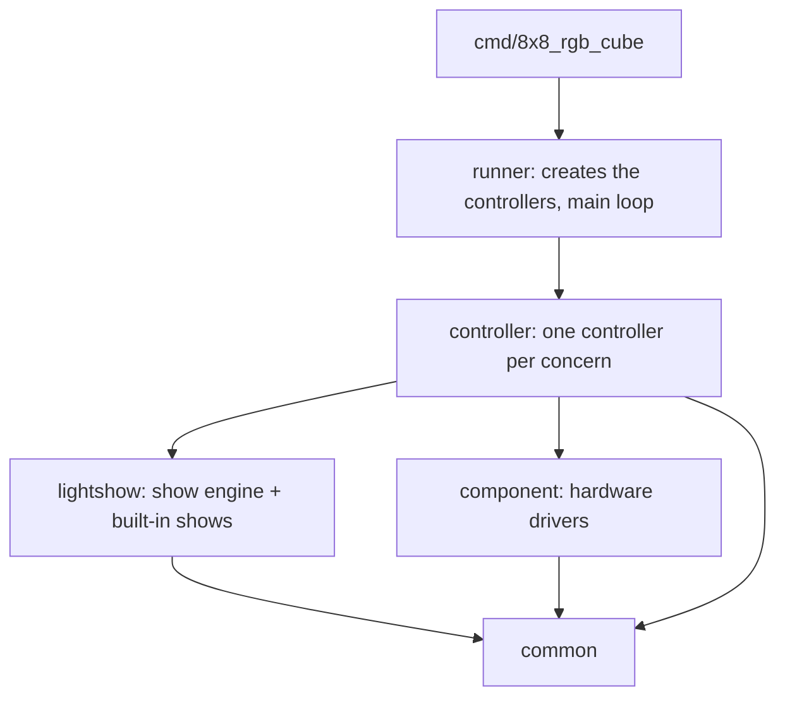

# Firmware

Written in Go, compiled with TinyGo for the GD32F103RET6 (STM32F103 target with a custom linker script).

## Structure

The firmware has four layers. Each layer only uses the ones below it:



| Package | Role |
|---|---|
| `cmd/8x8_rgb_cube` | Entry point |
| `cmd/gpio_diag` | GPIO register dump and key test program |
| `internal/runner` | Creates the controllers and runs the main loop |
| `internal/controller` | The controllers (below); each owns its components |
| `internal/lightshow` | Show engine: player, key functions, script VM. Knows nothing about the hardware |
| `internal/lightshow/blob` | Show data parser, graph decompression, name expressions |
| `internal/lightshow/render` | Canvas, graph blit/rotation, ball, title, point, line |
| `internal/lightshow/keyframe` | Shows written in Go (keyframed props, ASCII-art shapes, palettes) |
| `internal/lightshow/builtin` | Built-in shows (generated Go cartoons) |
| `internal/lightshow/oracle` | Frame-by-frame comparison with the vendor 3D Software's preview renderer |
| `internal/component` | Drivers of the physical parts: display scanner (with the frame bit layout), buttons, layer decoder, microphone (with the loudness meter), IR receiver, UARTs, EEPROM, flash, watchdog, status LEDs |
| `internal/common` | Small shared helpers (ASCII compare, `0`/`1` flags) |
| `tools/showgen` | Generates `internal/lightshow/builtin` from the factory show data |
| `tools/fwtool` | Extracts the show data from a vendor `.hex` or a flash dump |

Controllers:

| Controller | Owns | Does |
|---|---|---|
| `SystemController` | Debug port pins, watchdog, status LEDs | Startup banner, watchdog feeding, resets, memory reads |
| `SettingsController` | 24C02 EEPROM | Player settings record, factory cube type and serial number |
| `DisplayController` | MBI5024 chain + layer decoder (TIM2) | Shows frames, upside-down mounting, blanking |
| `KeyController` | KEY1–KEY7 | Key presses (from interrupts) and held keys |
| `RemoteController` | IR receiver | NEC decoding, remote button → key function |
| `ModeController` | DIP switches | Mode, the show of the mode (built-in or uploaded), upload slot state |
| `CascadeController` | UART2 (3.5 mm jacks) | Chain discovery, show clock, key Sync between cubes |
| `ShowController` | Player, microphone | Plays the mode's show on the display, key functions, cube placement, settings persistence |
| `TerminalController` | UART1 | Console commands, show uploads, registry |

`ShowController` uses the Display, Settings, Mode and Cascade controllers; `TerminalController` uses the System, Settings, Show and Key controllers. The others stand alone.

Only `lightshow` and `common` build and test on a PC (`go test ./internal/lightshow/...`); the rest uses the TinyGo `machine` package.

## Modes

DIP switches SW1/SW2 select the mode ([hardware.md](hardware.md#dip-switches)):

| Mode | Show |
|---|---|
| Dynamic | Built-in, 41 cartoons |
| Audio | Built-in, 10 cartoons |
| Test | Built-in, 4 cartoons |
| Text | Uploaded show data, all its groups in order; nothing if no show was uploaded |

The switches are polled about every 10 ms; a new position must read the same 3 times in a row. A change switches the show at once, without a reset: the log prints `Mode=<name>`, the player starts the new show at its first cartoon and keeps speed, play model, pause and display off. A paused cube draws the first frame of the new show and stays paused.

## Startup

The runner creates the controllers in this order:

1. System: disables the JTAG/SWD port (frees PA13, PA14, PA15, PB3, PB4), status LEDs, starts the watchdog.
2. Settings (EEPROM), Display (scanner on TIM2), Keys (EXTI, falling edge, 30 ms debounce), Mode (reads the DIP switches), Cascade (UART2).
3. Show: microphone (ADC1 + TIM3), builds the mode's show, restores the saved settings.
4. Remote (IR receiver on EXTI6), Terminal (UART1, loads the registry: `Regedit format error!` if empty).

Then it starts:

1. Print `Led Cube is starting up` (and `Watchdog reset!` if the watchdog caused the reset), `T='<type>'`, blink the green LED 3 times, print `Config1=…,Config2=…`.
2. Cascade discovery (~1.1 s) while still serving UART1.
3. Place the display (`Total=`, `Run x=…`) and start the main loop.

## Main loop

```text
forever:
  show.Step: step the player, show a new frame, apply display off
  until the frame's time is over (show clock), every 10 ms:
    system.Feed: feed the watchdog
    terminal.Poll: console commands, upload frames, a pending reboot
    show.Poll: DIP switch change (switch the show), save settings if due
    cascade.Keys(keys.Take, keys.Held): master sends Sync every 8 ms, slave reads Syncs;
        show.RunKeys runs the key functions of the rising key bits
    master: show.Action(remote.Take) for an IR button
    if the show was replaced (mode change, upload) stop waiting
```

Key presses come from interrupts and are queued; key functions always run in the main loop.

## Interrupts and timers

| Source | Use | Priority |
|---|---|---|
| TIM2 | Display refresh, 120/360/720 µs steps | default |
| TIM3 | Microphone sampling, 1 kHz | default |
| TIM4 | TinyGo runtime tick (`time.Sleep`, `time.Now`) | `0xC1` |
| EXTI (keys, IR) | Edge timestamps with `time.Now` | lowered to `0xE0` |
| IWDG | Watchdog, resets the MCU when the main loop stops feeding it for ~3 s | |

Pin interrupts must have a lower priority than the runtime tick: `time.Now` in an EXTI handler spins forever if the tick timer overflows while the handler runs at a higher priority.

The watchdog uses TinyGo's `machine.Watchdog` with a 4 s timeout. TinyGo computes it for a 32.768 kHz clock, but the F1's internal LSI oscillator runs at about 40 kHz (30–60 kHz), so the real timeout is about 3.2 s (2.1–4.3 s). Once started it can't be stopped; it ends only with a reset. The ROM bootloader (BOOT0) doesn't start it.

## Build

Requirements: Go 1.24+, TinyGo 0.39+ (tested with 0.43), STM32CubeProgrammer for flashing over UART.

```bat
scripts\build.cmd                    rem builds ./cmd/8x8_rgb_cube into bin\main.hex
scripts\build.cmd ./cmd/gpio_diag    rem another program, same output file
```

Equivalent command:

```sh
tinygo build -o bin/main.hex -target targets/gd32f103re.json -opt s -panic print -gc conservative ./cmd/8x8_rgb_cube
```

The target `targets/gd32f103re.json` inherits `bluepill-clone` and uses `targets/gd32f103re.ld` (350 KB code, 64 KB RAM, 4 KB stack). Run builds from the repository root (the linker script path is relative).

Host tests:

```sh
go test ./internal/lightshow/...
```

## Flashing

The kit has no SWD header, so flashing uses the ROM bootloader on UART1.

1. Connect a 3.3 V USB-UART adapter to the core board header: GND–GND, TXD–TXD, RXD–RXD (swap TX/RX if the bootloader doesn't answer). Disconnect the Pico.
2. Fit the BOOT0 jumper and press Reset.
3. `scripts\flash.cmd [COMx] [file]` (default COM4, builds and flashes `bin\main.hex`). It writes, verifies and starts the program (`-g 0x08000000`).
4. Remove BOOT0 so the cube starts normally after the next power cycle.

STM32CubeProgrammer CLI commands (bootloader runs 8E1 at 115200):

```powershell
$cp = "C:\Program Files\STMicroelectronics\STM32Cube\STM32CubeProgrammer\bin\STM32_Programmer_CLI.exe"
& $cp -c port=COM4 br=115200                                                  # connect, chip info
& $cp -c port=COM4 br=115200 -u 0x08000000 0x80000 firmware\FullDump_512K.bin # read all flash (~70 s)
& $cp -c port=COM4 br=115200 -w bin\main.hex -v -g 0x08000000                 # write, verify, run
& $cp -c port=COM4 br=115200 -e all -w firmware\FullDump_512K.bin 0x08000000 -v -g 0x08000000  # restore a dump
```

Writing erases only the pages the file covers, so the show slot and registry survive a firmware update.

## Scripts

| Script | Does |
|---|---|
| `scripts\build.cmd [package]` | TinyGo build into `bin\main.hex` |
| `scripts\flash.cmd [COMx] [file]` | Build (if no file is given) and flash over the ROM bootloader |
| `scripts\dump.cmd [COMx]` | Read the whole 512 KB flash into `firmware\dump_<timestamp>.bin` |
| `scripts\monitor.cmd [COMx] [baud]` | `tinygo monitor` on the console port |
| `scripts\terminal.cmd [COMx] [baud] [command]` | Interactive console: typed lines are sent as `#?line?!`. With a command it sends it once and prints the reply |
| `scripts\upload.cmd [COMx]` | Starts the vendor "Download Software" at 115200 baud for a show upload |
| `scripts\test-oracle.cmd` | Compares the engine's frames with the preview renderer of the vendor 3D Software (Windows, 32-bit Go, the vendor software must be present) |

`CUBEPROG` overrides the STM32CubeProgrammer path, `ICUBE_DOWNLOAD` the Download Software path.

## Uploading shows from the vendor software

1. Design a show in the iCubeSmart "3D Software - RGB" and export `Update.hex`.
2. Run `scripts\upload.cmd COMx` and download `Update.hex` in the tool.
3. Set SW1 and SW2 to ON (Text mode) to play it.

Protocol details: [serial-protocol.md](serial-protocol.md#show-upload).

## MCU pitfalls

### TinyGo pull-up bug

TinyGo's STM32F1 `Pin.Configure` writes the 5-bit mode value `PinInputPullup` (`0x18`) into the 4-bit pin field without masking. Bit 4 spills into bit 0 of the **next pin's** field, turning that pin into a 10 MHz output (or changing its output speed). On this board configuring KEY6 (PA13) breaks KEY5 (PA14), KEY4 breaks PB4, SW2 breaks LE (PC4), and so on.

Workaround used everywhere: configure `PinInputPulldown` (`0x08`, no spill) and then call `pin.High()`; in input-pull mode the output data bit selects pull-up. The upstream fix is to mask the value with `0xF` in `machine_stm32f103.go`.

### Debug port pins

After reset PA13/PA14 are SWDIO/SWCLK and PA15/PB3/PB4 are JTAG. The debug port forces its own pulls, so KEY5 never reads low until `AFIO_MAPR.SWJ_CFG = 100` (all debug pins released). The AFIO clock must be on to write it. After that SWD can't attach to the running chip; use the BOOT0 bootloader (or connect under reset).

`SWJ_CFG` is write-only on STM32 (reads undefined) but reads back on this GD32; any later read-modify-write of `AFIO_MAPR` should keep or rewrite it.

### EXTI lines

EXTI lines are shared per pin number across ports: KEY2 (PC1) and SW1 (PA1) share line 1, KEY4 (PB3) and SW2 (PC3) share line 3. Only one pin per line can interrupt, so the keys use EXTI and the switches are polled.

### Keys

Keys are active low: interrupts trigger on the falling edge (a rising-edge interrupt would fire on release). Presses closer than 30 ms are treated as bounce.

### RAM and code size

- `strings.EqualFold`, `strings.Fields` and similar Unicode-aware functions pull large tables into RAM; the firmware uses ASCII-only helpers.
- The default `bluepill-clone` target is limited to 64 KB of flash and 20 KB of RAM; the custom target opens the full 512 KB / 64 KB.
- Built firmware: about 158 KB flash, 10 KB RAM.

### Serial output

`println` goes to UART1 and ends lines with `\r\n`. Console replies use the same port.
