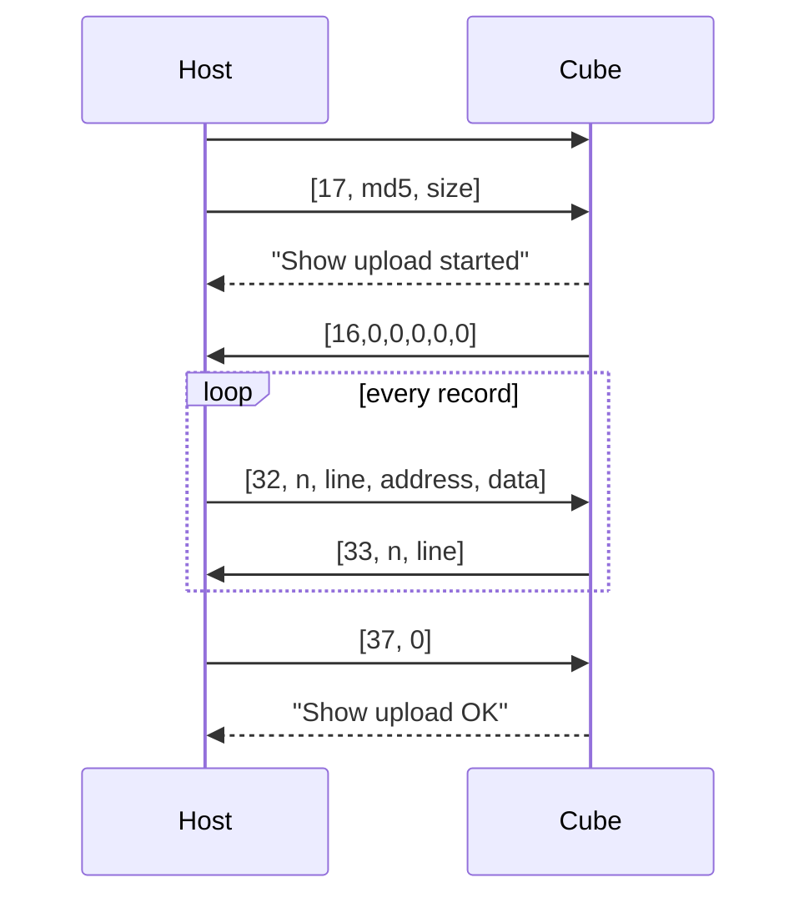

# Serial protocols

## UART1 (console, uploads, Pico)

USART1 on the core board's 4-pin header: TX = PA9, RX = PA10, **115200 baud, 8N1**, 3.3 V logic. (The factory firmware runs it at 921600.)

One byte stream carries three things:

| Direction | Content | Format |
|---|---|---|
| to the cube | Console commands | `#?<command line>?!` |
| to the cube | Upload frames | `A5 05 len payload check 55` |
| from the cube | Log and command replies | ASCII lines ending in `\r\n` |
| from the cube | Upload replies | `A5 05 len payload check 55` |

Bytes that are neither part of a command nor of a frame are ignored. A gap of more than **1 s** inside a command or frame discards it.

Any host (a PC terminal, the vendor upload tool, the Raspberry Pi Pico) uses this same protocol. There is no other link protocol.

### Console commands

Framing: `#?` + command line + `?!`, at most 180 characters between the markers. The line is split on spaces; the command name is case-insensitive. Numbers are decimal, or hexadecimal with a `0x` prefix. An unknown command prints the Help line `Help\t\t:Commands explain`.

| Command | Reply lines | Notes |
|---|---|---|
| `Help` | `Commands explain:-----------------`, then `<name>\t\t:<help>` per command (one tab if the name has 8+ characters) | |
| `ReBoot` | `System Reboot!` | Resets 300 ms later. An upload connect frame within that time cancels the reset |
| `ReadMem <address> <offset> <count>` | `DoReadMemery:-----------------`, `Address=0x%08X,offset=%d,count=%d`, rows of 16 `XX ` bytes, `ReadMemery End!` | Reads `address+offset`. Allowed: flash `0x08000000–0x0807FFFF`, SRAM `0x20000000–0x2000FFFF`, system memory `0x1FFFF000–0x1FFFF80F`. Errors: `Param Number Error!`, `Address Error!` |
| `SetReg <key> <value>` | `DoWriteRegedit:-----------------`, `WriteReg:<key> OK!` | Errors: `WriteReg Param Number Error!`, `WriteReg Error!`, `Save Regedit Error!` |
| `GetReg <key>` | `DoReadRegedit:-----------------`, `ReadReg:<key>=<value>` or `Not Found <key>` | Error: `ReadReg Param Number Error!` |
| `RegList` | `DoGetRegeditList:-----------------`, `Regedit Count = <n>`, `<key>=<value>` per entry | |
| `DelReg <key>` | `DoDeleteRegedit:-----------------`, `Delete Regedit:<key> OK!` | Also printed when the key didn't exist. Error: `DelReg Param number is error!` |
| `ClrReg` | `DoCleanRegeditList:-----------------`, `Clean Regedit OK!` | |
| `SetType <type>` | `DoSetType`, `System Reboot!` | Writes the type string (≤ 8 chars) to EEPROM `0xA8`. Errors: `Argc number Error!`, `SetType Error!` |
| `SetSerial <16 hex digits>` | `DoSetSerial`, `System Reboot!` | Writes 8 bytes to EEPROM `0xA0`. Errors: `Argc number Error!`, `SetSerial Error!` |
| `Test` | `DoTest` | No effect |
| `Key <1-7>` | none | Presses a key, exactly like the physical key ([below](#control-commands)) |
| `Action <1-19>` | none | Runs a key function code |
| `Cartoon <index>` | `Change Cartoon <index>` | Plays cartoon *index* (0-based) of the current show |
| `Status` | `Status:<fields>` | Player state |

Registry limits and storage: [storage.md](storage.md#registry).

### Control commands

`Key`, `Action`, `Cartoon` and `Status` drive the show player. The factory firmware doesn't have them.

- If the player isn't set up yet they reply `Not Ready!` (the firmware sets it up before it starts reading UART1, so this is a safeguard only).
- A bad or out-of-range argument replies `Param Error!`.
- On success there is no direct reply; the action's own log line follows (see [Log output](#log-output)). Send `Status` to read the result.
- `Key n` goes through the cascade key mask: it runs on the next sync tick (≤ 8 ms later), prints `DoKey<n>` and then the action message, and cascaded cubes follow it. On a cascade slave it has no effect (slaves follow the master's keys).
- `Action` and `Cartoon` run at once and only on the cube that received them, like the IR remote.
- `Action` codes are the key function codes in [show-engine.md](show-engine.md#key-functions).

`Status` reply, all on one line:

```text
Status:Mode=Dynamic,Cartoon=3,Count=41,Speed=1.00,PlayModel=1,Pause=0,DisplayOff=0,DeviceNum=0
```

| Field | Values |
|---|---|
| `Mode` | `Dynamic`, `Audio`, `Test`, `Text` |
| `Cartoon` | Index of the playing cartoon, 0-based |
| `Count` | Number of cartoons in the show (0 = nothing to play, e.g. Text mode without an uploaded show) |
| `Speed` | `0.10`, `0.20`, `0.50`, `0.70`, `1.00`, `1.50`, `2.00`, `3.00` |
| `PlayModel` | `1` = play all cartoons in turn, `0` = repeat the current one |
| `Pause` | `1` = paused |
| `DisplayOff` | `1` = LEDs off (the show keeps running) |
| `DeviceNum` | Position in the cascade chain, 0 = master |

### Log output

The firmware prints these lines (each ends in `\r\n`).

At power-up:

```text
Regedit format error!                (only when the registry flash pages are empty or invalid)
No uploaded show                     (Text mode only; or "Uploaded show: <n> cartoons")
Led Cube is starting up
T='8x32x8b'                          (cube type from the EEPROM)
Config1=0,Config2=0                  (mode number, SW3/SW4 bits: bit 0 = SW3 ON, bit 1 = SW4 ON)
DeviceType=1,DeviceNum=0             (1 = cascade master)
Total=1                              (cubes in the show's display table)
Run x=0,y=0,z=0,dir=0,type=7         (this cube's display position; type = cube type index)
```

While running:

| Line | When |
|---|---|
| `DoKey<n>` | Key *n* runs (physical key, `Key` command or cascade) |
| `IR:<hex code>` | IR remote button received |
| `Replay Cartoon`, `Previous Cartoon`, `Next Cartoon` | Key functions 1–3 |
| `Add speed to <s>`, `Speed reset to <s>`, `Sub speed to <s>` | Key functions 4–6 (only when the speed changes) |
| `Play Model=<0/1>` | Key function 7 |
| `DeviceSuppend:<0/1>` | Key function 8 (pause; spelling as in the factory firmware) |
| `Display off=<0/1>` | Key function 9 |
| `Change Cartoon <n>` | Key functions 10–19, `Cartoon` command |
| `Mode=<name>` | DIP switches changed; followed by `Total=` / `Run ` lines (and the Text mode show line) |
| `Show upload started` | Upload connect frame received |
| `Show upload OK` / `Show upload failed` | Upload end frame received |
| `Not found <kind>:'<name>'` | A cartoon refers to a missing graph, palette or index |
| `Warn: Pos > Cubes, <num>,<count>` | Cascade position beyond the show's display table |
| `Warn: display dir <d> is not supported` | Show display entry with dir ≠ 0 |
| `Save settings error!` | EEPROM write failed |

Scripts in uploaded shows can print their own lines (`TraceN`).

## Show upload

The upload uses the frame protocol of the vendor "Download Software". Any client can use it.

### Frames

```text
A5 05 len payload[len] check 55
```

- `len` = payload length, 1–179.
- `check` = XOR of every other byte of the frame: `A5 ^ 05 ^ len ^ payload... ^ 55`.

### Messages

| Direction | Payload | Meaning |
|---|---|---|
| host → cube | `17, md5[16], size u32` | Connect. The md5 and size are ignored |
| cube → host | `16, 0, 0, 0, 0, 0` | Ready (a non-zero second byte would mean "nothing to do"; this firmware always sends 0) |
| host → cube | `32, n, line u16 BE, address u32 BE, data[n]` | One record of `n` bytes at a flash `address` |
| cube → host | `33, n, line u16 BE` | Record stored (echoes `n` and `line`) |
| host → cube | `37, 0` | End (the vendor tool sends it twice) |

### Sequence



- The cube keeps only bytes inside the **show region `0x0800B000–0x080320FF`** (160 000 bytes). Address `0x0800B000` is offset 0 of the show data ([show-data.md](show-data.md)). Records outside the region are acknowledged and dropped, so a full vendor `Update.hex` (a complete firmware image) can be sent as is.
- Each 2 KB page of the show slot is erased the first time a record touches it. The CPU stalls during an erase (the display blinks off for a moment), so the host **must wait for each `33` reply** before sending the next record. The vendor tool gives up after 200 ms without a reply.
- If a record can't be stored the cube sends no reply and the upload ends as failed.
- Records sent without a connect frame are ignored.
- While an upload runs, Text mode shows nothing; at the end Text mode loads the new show. In other modes the show is stored and used the next time Text mode is selected.
- The stored show survives power cycles.

The vendor tool sends `#?reboot?!` before connecting (the factory firmware reboots into its bootloader). This firmware delays the reboot by 300 ms and the connect frame cancels it. Other clients should simply not send `ReBoot`.

Recommended client behavior: records of 16–128 data bytes (`n` ≤ 171), `line` = record counter, wait up to 1 s for each reply, retry a record once on timeout.

### Mixed output

During an upload the cube's output contains both binary reply frames and text lines (e.g. `Show upload started` arrives before the ready frame). A client reading the stream should treat `A5 05` as the start of a frame and everything else as text. Log lines are ASCII (only registry values typed by a user could contain other bytes).

## Cascade (UART2)

Several cubes can be chained with 3.5 mm cables: **TX jack of one cube → RX jack of the next**. USART2, TX = PA2, RX = PA3, 115200 baud, 8N1. The RX pin has a pull-up so an empty jack reads idle.

### Frames

```text
A5 55 len payload[len] xor
```

`len` = 1–15 (receivers accept up to 16), `xor` = `len ^ payload bytes`.

| Message | Payload |
|---|---|
| Hello | `01` |
| Number | `02, n` (position of the receiving cube) |
| Sync | `20, clock u64 LE (ms), key mask` |

### Discovery (at power-up, about 1.1 s)

1. Wait 100 ms.
2. Send Hello 5 times, 100 ms apart. A cube that receives a Hello during this phase has a cube upstream, so it is a **slave**; otherwise it is the **master** (position 0).
3. Master: send `Number 1` 5 times, 100 ms apart.
4. Slave: wait up to 500 ms for `Number n`, take position *n* and send `Number n+1` downstream.
5. Print `DeviceType=<1 master / 0 slave>,DeviceNum=<n>`.

### Running

- Every 8 ms the master sends Sync with its show clock and key mask. Slaves forward each Sync downstream, adopt the clock and run the key functions for the bits that went from 0 to 1. The master runs the same key functions at the same time, so all cubes stay in step.
- Frame timing on every cube follows the master's clock.
- Slaves ignore their own keys, IR remote and `Key` commands. IR codes and the `Action`/`Cartoon` commands are not forwarded.
- Key mask: bit *n* = KEY(*n*+1). A press sets its bit for 3 Sync frames; a key held longer keeps its bit set.
- Each cube draws its part of the show using the display table of the show data: entry *DeviceNum* gives its x, y, z offset. Built-in shows have a single entry, so every cube shows the same thing.

## IR remote

NEC protocol on PC6. Timings (µs) accepted by the decoder, measured between edges:

| Symbol | Mark | Space |
|---|---|---|
| Leader | 7001–10999 | 3501–5499 |
| Repeat | 7001–10999 | 1751–2749 (ignored) |
| Bit 0 | 411–709 | 411–709 |
| Bit 1 | 411–709 | 1281–2079 |

32 bits in four bytes: address, ~address, command, ~command. The firmware stores each byte MSB first (the first bit received is bit 7), which gives the codes usually printed for these 21-key remotes. A frame is valid when both complements match. The firmware uses `code = address << 8 | command`; the kit remote's address is `0x00`, so codes are the command byte.

| Code | Button | Action |
|---|---|---|
| `A2` | CH− | 9 Display off |
| `E2` | CH+ | 7 Play model |
| `E0` | VOL− | 2 Previous |
| `90` | EQ | 3 Next |
| `A8` | VOL+ | 8 Pause |
| `02` | ▶▶\| | 4 Speed up |
| `98` | 100+ | 6 Speed down |
| `C2` | ▶\|\| | 5 Speed reset |
| `B0` | 200+ | 1 Replay |
| `68`, `30`, `18`, `7A`, `10`, `38`, `5A`, `42`, `4A`, `52` | 0–9 | 10–19 Play cartoon 0–9 |
| `22`, `62` | \|◀◀, CH | none |
